# AnonPDF

[](https://github.com/FanFeast/anonpdf/actions/workflows/build.yml)
[](LICENSE)
[](#requirements)
[](#the-guarantee-and-how-to-check-it)

A PDF reader and editor for Android that does its work on your device and nowhere else.

**No ads. No accounts. No tracking. No paid tier. No network permission.**

AnonPDF exists because every other PDF app on the Play Store seems to want a
subscription, a cloud account, and a look at your documents. This one wants none
of those. It cannot upload your files, because it has no permission to reach the
network — that is not a promise in a privacy policy, it is a fact enforced by the
operating system.

| Library | Reading | Your files |
|---|---|---|
| 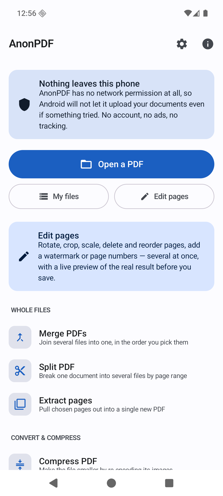 | 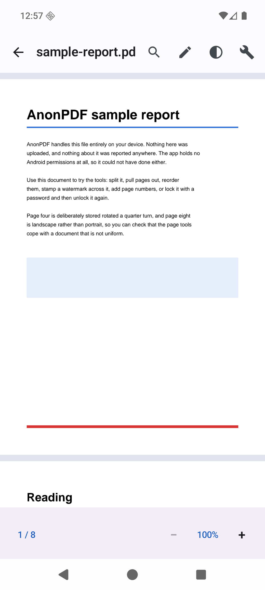 | 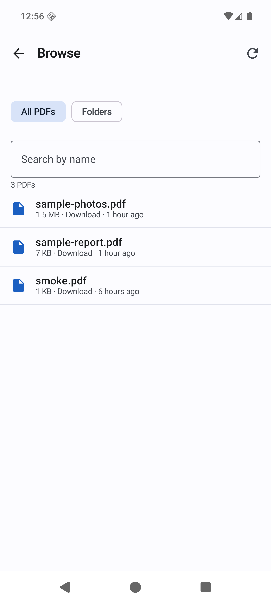 |

## The editor

Most of the work happens here. Pick pages, stack up as many changes as you like,
watch the real rendered output update as you go, and write the file once at the
end. Nothing touches disk until you save, and the original is never modified.

| Editing | Drag to reorder | Fold the tools away |
|---|---|---|
| 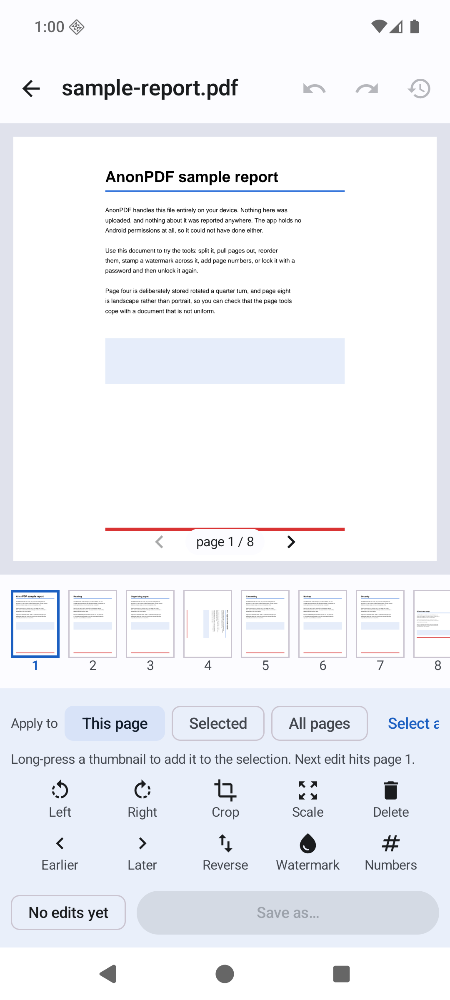 | 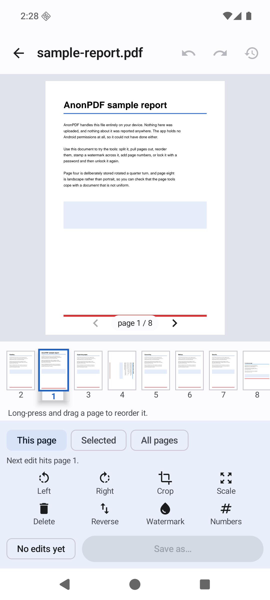 | 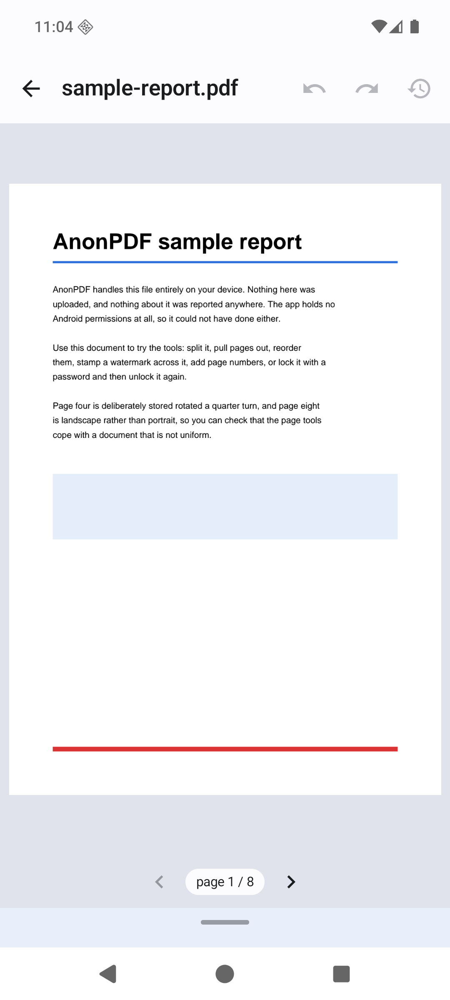 |

| Cover it and retype it | Highlight and draw | Merge in, then keep editing |
|---|---|---|
| 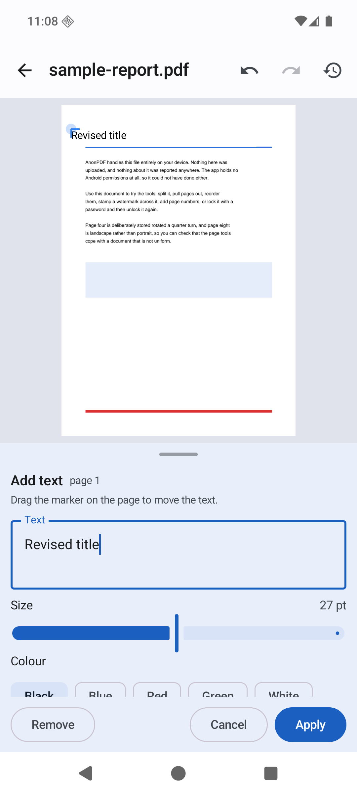 | 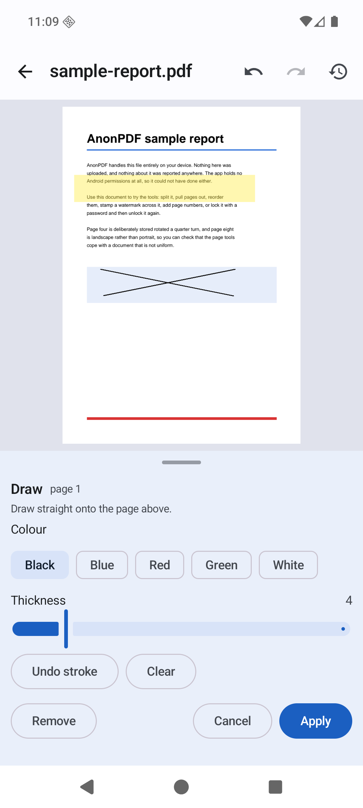 | 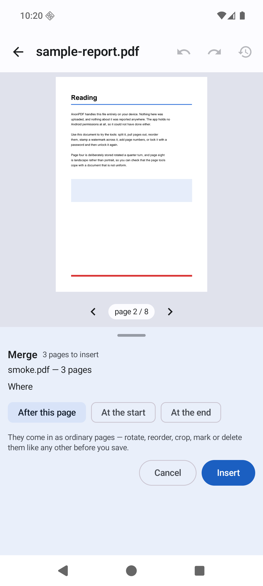 |

| Visual crop | Fit onto A4, Letter, … | Watermark |
|---|---|---|
| 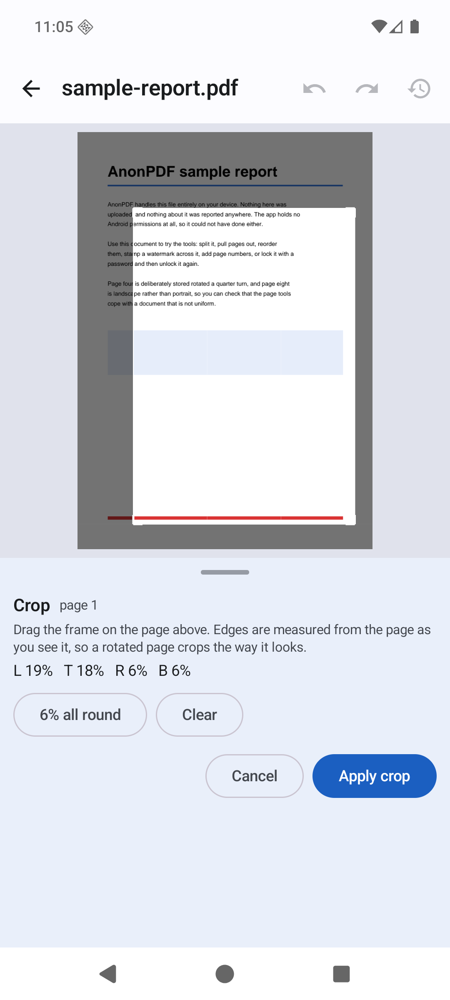 | 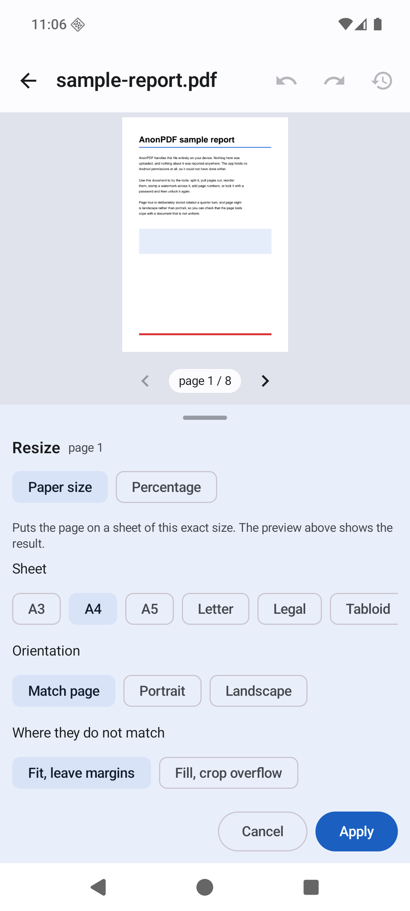 | 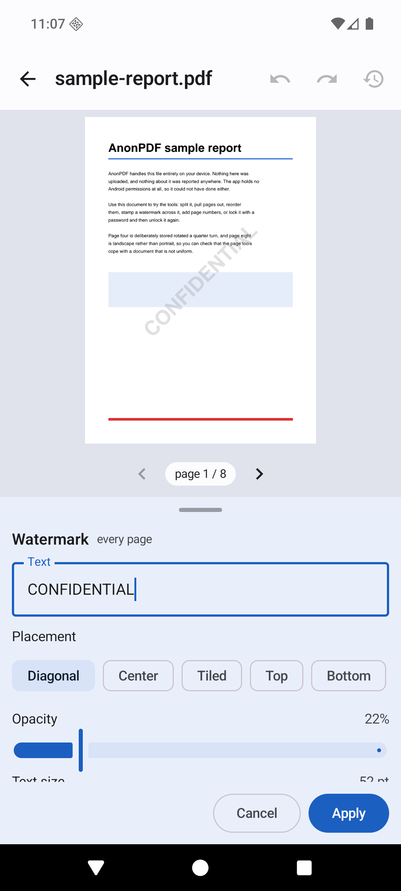 |

Rotate, crop, resize, delete, restore, reverse, add text, white-out, highlights,
drawings, a watermark and page numbers — each applied to **this page**, a
**selection**, or **all pages**. Undo and redo the whole history.

- **Every tool lives here**, on four swipeable pages: *Pages*, *Content*,
  *Whole file*, *Convert & lock*. The whole-file ones receive the document with
  your pending edits already applied, so "delete three pages, then compress"
  means what it looks like it means.
- **Merge inserts, right where you say.** Pick another PDF (or several) and its
  pages drop into the document — after the current page, at the start, or at
  the end — as ordinary pages in the strip. Reorder, rotate, crop, mark or
  delete them like any other, then save once. No separate merge screen, no
  merge-then-reopen round trip.
- **The tool area is a drawer.** Drag its handle up for more room, or tap it to
  fold everything away and read the page full-height.
- **Edit the content, not just the pages.** Cover something with a white-out
  block and type your own text on top, highlight a passage, or draw on the page
  freehand. (A PDF's existing text cannot be rewritten in place without the
  document's own embedded fonts — cover-and-retype is the honest way to change
  it, and it is what the app does.) A white-out genuinely removes what it
  covers: the page is flattened into an image under the box, so the hidden text
  cannot be copied, searched or extracted afterwards. The trade-off is that the
  rest of that page's text stops being selectable too.
- **Reorder by dragging.** Long-press a thumbnail and drag it; a gap opens where
  it will land, and the strip auto-scrolls when you reach an edge.
- **Multi-select by tapping.** Switch the scope to *Selected* and plain taps
  toggle pages, so picking several is one tap each.
- **Options open in place**, under the preview rather than over it, so you can
  drag a slider and watch the page change.
- **Size changes are shown, not re-fitted.** The preview is fitted to the page
  as it arrived, so scaling to 50% draws it half as wide instead of quietly
  filling the screen again.

The preview is not an approximation. It is built by the same code that writes the
final file, and a test renders both and asserts they match pixel for pixel.

## The guarantee, and how to check it

AnonPDF declares exactly **one** permission:

```
android.permission.MANAGE_EXTERNAL_STORAGE
```

That is what lets the built-in browser list the PDFs on your device instead of
making you walk the system file picker every time. It is **optional** — decline
it and everything still works through the picker, which needs no permission at
all.

Being straight about one thing: all-files access is a *special app access*, a
toggle under Settings → Apps → Special app access → All files access. It does
**not** appear on the app's normal "Permissions" page, which will read "No
permissions requested" even when it is granted. So do not take that screen as
proof of anything either way.

What you can rely on:

- **No `INTERNET` permission.** The kernel refuses outbound sockets. There is no
  server, no telemetry endpoint, no crash reporter, no ad network. The test suite
  asserts that opening a socket *and* resolving a hostname both actually fail.
- **No analytics or advertising dependencies.** The whole list is in
  `gradle/libs.versions.toml`: AndroidX, Kotlin, and PdfBox-Android.
- **`allowBackup=false`** plus explicit backup exclusion rules, so documents
  cannot leave via cloud backup or device transfer either.
- **A test that fails the build** if any permission other than the one above
  appears in the merged manifest — see
  [`PrivacyContractTest`](app/src/androidTest/java/io/github/fanfeast/anonpdf/PrivacyContractTest.kt).

Verify the built artifact yourself:

```bash
apkanalyzer manifest permissions app-release.apk
```

### What it stores

| What | Where | How to remove |
|---|---|---|
| Names + URIs of up to 20 recent files | App-private storage, excluded from backup | Settings → Clear recent files, or switch off "Remember recent files" |
| Working copies of the file being edited | App cache | Settings → Delete temporary working files; also cleared on every launch |
| Three display preferences | App-private storage | Uninstall |

That is the complete list. No identifier of any kind, no first-run ID, no
advertising ID.

## Features

**Reading**
- Continuous vertical scroll, rendered by Android's own `PdfRenderer`
- Pinch to zoom, with pages redrawn sharply at each zoom level
- Jump to page, text search, night mode
- Opens password-protected PDFs
- Registers as a PDF handler, so other apps can open documents in it

**Finding files**
- Built-in browser: every PDF on the device, newest first, searchable by name
- Or browse by folder
- Or the system picker, if you would rather not grant file access

**Editing** (all in one pass, with live preview)
- Rotate, crop with draggable handles, delete, restore
- Resize: scale by percentage, or refit onto A3, A4, A5, Letter, Legal or Tabloid
- Reorder page by page, or reverse the whole document
- Merge other PDFs in at any position, then edit their pages like any other
- Add text; remove content with a white-out block (the page is flattened, so it is really gone); highlight; draw freehand
- Text watermark: diagonal, centred, tiled, top or bottom
- Page numbers with a format template, position, start number, and cover-skipping
- Applied per page, to a selection, or to everything

**Whole-file jobs**
- Merge several PDFs into one
- Split into multiple files by page range, or every N pages
- Extract chosen pages into a new document
- Compress — two modes: re-encode images only (text stays selectable), or
  flatten pages to images for the smallest file. The UI says which trade-off you
  are making.
- PDF → JPG or PNG at a chosen resolution
- Images → PDF, honouring EXIF rotation, with A4 / Letter / fit-image sizing
- Extract text to a `.txt` file
- Protect with AES-256 password, or remove a password you know
- Sign: draw your signature and place it on a page

## Deliberately not included

Being honest about the edges rather than shipping something that half-works:

- **Word / Excel / PowerPoint conversion.** Doing it properly needs a full
  office-document engine. A bad converter is worse than no converter.
- **OCR.** Reading text out of scanned images needs a model, which means either a
  large bundled download or a server. Scanned pages are detected and the app
  says they contain no extractable text rather than silently returning nothing.
- **Cloud sync, accounts, sharing links.** The entire point is that nothing leaves.
- **Cryptographic digital signatures.** "Sign PDF" places an image of your
  signature on the page. It is ink on paper, not a certificate, and the app says
  so on screen.

## Requirements

- Android 12 (API 31) or newer
- About 15 MB installed

## Building

```bash
git clone https://github.com/FanFeast/anonpdf.git
cd anonpdf
./gradlew assembleDebug
```

You need JDK 17+ and an Android SDK with platform 37 and build-tools 36. Point
Gradle at your SDK with `local.properties`:

```properties
sdk.dir=/path/to/Android/Sdk
```

### Tests

```bash
./gradlew testDebugUnitTest          # 55 JVM tests: page ranges, edit-plan folding, render cap, UI logic
./gradlew connectedDebugAndroidTest  # device tests; needs a device or emulator
./gradlew :desktop-engine:test       # the engine on desktop: 108 tests, no device needed
./gradlew :desktop:test              # the desktop app, driven end to end
./gradlew :desktop:run               # run the desktop app
```

The engine's tests that need a renderer (every operation, and the editor's
preview-matches-export checks) live in `shared-engine/src/deviceTest` and run in
both the Android and the desktop suite. CI runs the desktop engine tests on Linux and
Windows.

The instrumented suite is where the real coverage lives. It builds PDFs, runs
every operation against them, and asserts on the results: page counts and order
after reorganising, crop boxes, scaling geometry, encryption round-trips,
compression ratios, page numbers reflecting the final order, rendered pixels for
the watermark, and that a preview matches its export exactly. Two of them exist
because a weaker version passed while the code was wrong: scaling is checked by
re-rendering and comparing the whole layout, not just the page dimensions, and
cropping is checked on a rotated page. It also asserts the privacy contract,
including that a socket connection and a DNS lookup both fail.

[`AppSmokeTest`](app/src/androidTest/java/io/github/fanfeast/anonpdf/ui/AppSmokeTest.kt)
drives the real UI: it launches the app, opens every screen reachable from Home
(including every tool in the catalogue) and comes back, and hands the app a PDF
through both "Open with" and "Share", checking it renders in the viewer and
opens in the editor.
[`ManifestContractTest`](app/src/androidTest/java/io/github/fanfeast/anonpdf/ManifestContractTest.kt)
pins the entry points other apps rely on: the launcher, "Open with" and "Share"
for PDFs, the private share-out provider, that nothing else is exported, and
that backup stays off. CI also builds the minified release bundle on every pull
request and checks its permissions, so a shrinker or manifest regression shows
up before a release is tagged.

### Desktop downloads

```bash
./gradlew :desktop:createReleaseDistributable            # shrunk app + trimmed Java runtime
desktop/packaging/linux/build-appimage.sh 1.0.0 dist     # -> dist/AnonPDF-1.0.0-linux-x86_64.tar.gz
pwsh desktop/packaging/windows/build-zip.ps1 -Version 1.0.0 -Out dist   # on Windows
desktop/build/compose/binaries/main-release/app/AnonPDF/bin/AnonPDF --self-test
```

Both downloads are portable: nothing is installed. Linux gets an AppImage inside
a `.tar.gz`, because tar keeps the executable bit that browsers strip, so it is
extract and double-click. The AppImage uses the static runtime, so it needs no
`libfuse2`, and its build tools are pinned by checksum. `--self-test` runs the
engine's riskiest paths inside the packaged app; CI runs it on every pull
request, on Linux and Windows, against the exact files it builds.

### Snap

`snap/snapcraft.yaml` packages the release build for the Snap Store, which is
what Ubuntu's App Center lists. It is strictly confined with no network plug;
it gets `home` (not hidden files) and `removable-media`. CI builds it, installs
it with that confinement, fails on any `network*` plug, and runs `--self-test`
inside it.

```bash
./gradlew :desktop:createReleaseDistributable
snapcraft pack        # builds in LXD; the version comes from the release build
sudo snap install --dangerous anonpdf_*.snap
```

### Release builds

Signing is opt-in. Create `keystore.properties` in the project root (gitignored):

```properties
storeFile=/absolute/path/to/upload.jks
storePassword=…
keyAlias=…
keyPassword=…
```

Then:

```bash
./gradlew bundleRelease   # .aab for Play
./gradlew assembleRelease # .apk for direct install
```

Without that file the release build still works, it just produces an unsigned
artifact.

## How it is put together

Kotlin, Jetpack Compose, no dependency-injection framework and no architecture
ceremony beyond what the size justifies. The PDF engine and the editor screens
and tool screens are shared with a desktop app for Linux and Windows, which is
built and tested on every change but not released yet.

```
shared-engine/src/     The engine, shared by Android and desktop. File in, file out.
├── main/.../pdf/
│   ├── PdfEditor.kt     Edit ops → normalised plan → apply / preview
│   ├── PdfOps.kt        Merge, split, extract, crop, security, text
│   ├── PdfConvert.kt    Compression, page export, images → PDF
│   ├── PdfDraw.kt       Single-page drawing shared by editor and tools
│   └── PageRanges.kt    Parses "1-3, 5, 9-12"
├── test/              JVM tests, run on both platforms
└── deviceTest/        Engine tests that need a renderer: on a device for
                       Android, as plain tests on desktop

app/src/main/java/io/github/fanfeast/anonpdf/
├── pdf/          Android's half of the engine
│   ├── Platform.kt      What the engine's image and size types are here
│   ├── PdfRasterizer.kt Wraps android.graphics.pdf.PdfRenderer
│   └── DocumentStore.kt Moves bytes between SAF and the private cache
├── ui/common/Platform.kt  What the shared screens' file types and pickers are here
├── storage/      Optional all-files access and the PDF scanner
├── data/         Recent files and preferences (DataStore)
└── ui/           Android-only screens: home, viewer, browser, settings, about

shared-ui/src/main/.../ui/   Screens shared with the desktop app: the editor,
                             the tools and Sign, theme, common components

desktop-engine/   The engine compiled for Windows and Linux (see below)
desktop/          The desktop app: a native window, no browser, with the
                  editor and every tool behind a sidebar; files can be
                  dragged onto it from the file manager
```

Four decisions worth explaining:

**Rendering uses the platform.** `android.graphics.pdf.PdfRenderer` is already on
every device, sandboxed by the OS, and costs nothing in APK size. PdfBox-Android
handles document *structure* — it is not used for rasterising.

**Edits are a list of operations, not mutations.** The editor keeps an ordered op
list and derives a normalised `EditPlan` from it. Undo is dropping the last op
and recomputing. Preview and export both consume that same plan, which is why
they cannot drift apart.

**Preview builds a one-page document.** Rather than applying the plan to the whole
file, preview extracts the page being shown, applies the plan's page-scoped and
document-scoped operations, and renders that. A 400-page file previews as fast as
a 4-page one.

**One engine source, two PDFBox builds.** Android uses PdfBox-Android, a port of
PDFBox with the same API under another package name (`com.tom_roush.pdfbox`).
The engine is written once against it, and `desktop-engine` compiles a copy
generated at build time with the upstream package name (`org.apache.pdfbox`) put
back. What genuinely differs per platform — the image type, and how a page is
rasterised (Android's built-in renderer; PDFBox's own on desktop) — is a small
file on each side. The same editor tests run against both.

The editor screens are shared the same way, without the rename: Compose
Multiplatform uses Jetpack Compose's own `androidx.compose` packages. Each side
has a small `Platform.kt` saying what a document reference is (a content URI on
Android, a file on desktop), how the user picks one, and how a photo is read
upright, plus its own result card for saving. On a wide screen the editor puts
its controls in a panel beside the page instead of a drawer under it. Files
dropped onto the desktop window reach the shared screens through `DropInbox`,
which does nothing on Android, so each screen decides for itself what a dropped
file means.

**Page edits happen in place.** Reordering or deleting pins each page's inherited
attributes, detaches every page from the page tree, then re-attaches them in the
new order. The obvious alternative — copying pages into a fresh document —
silently drops annotations and page-tree-inherited resources.

BouncyCastle, which ships with PdfBox, is excluded from the build. PdfBox only
reaches it for certificate-based encryption, which this app does not offer;
password protection uses the platform's own JCE. Dropping it removed about 4 MB
of unused code, most of it post-quantum algorithms, and the encryption tests
prove the remaining paths still work.

## Licence

MIT. See [LICENSE](LICENSE).

Third-party components and their licences are listed in the app under
**About → Open source licences**.
