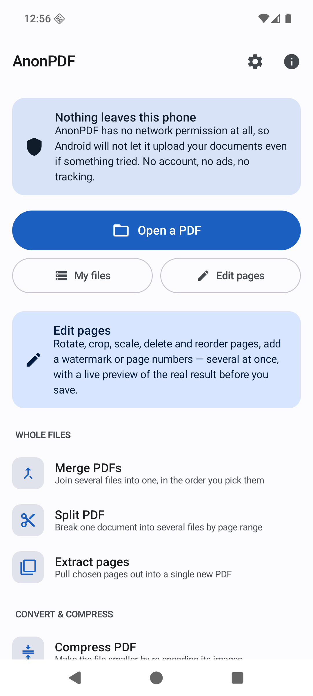
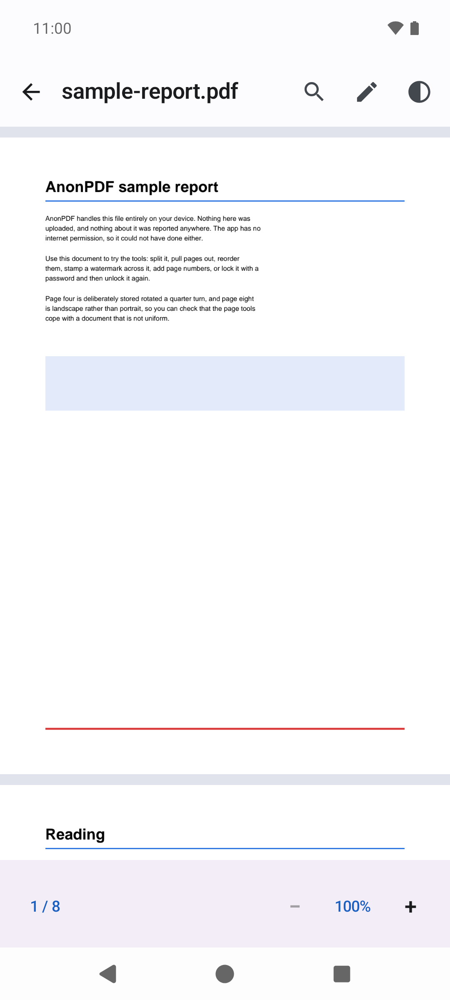
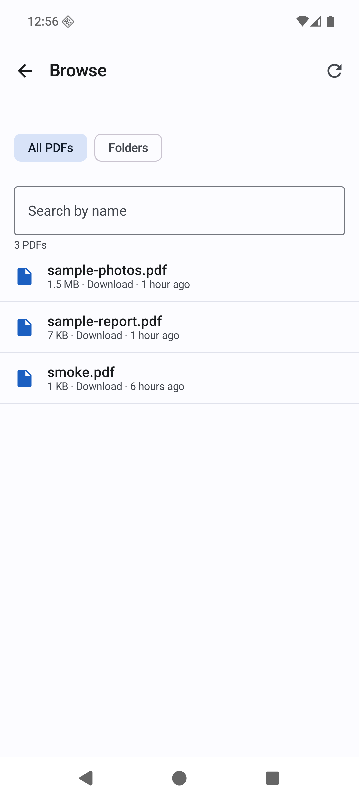
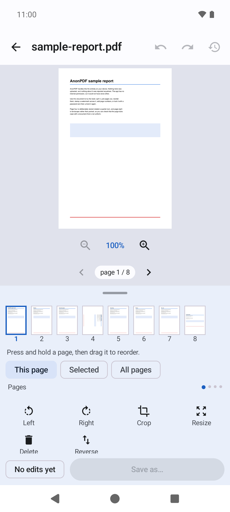
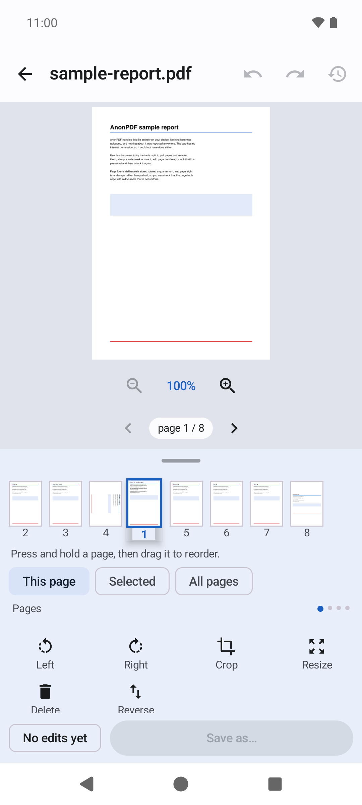
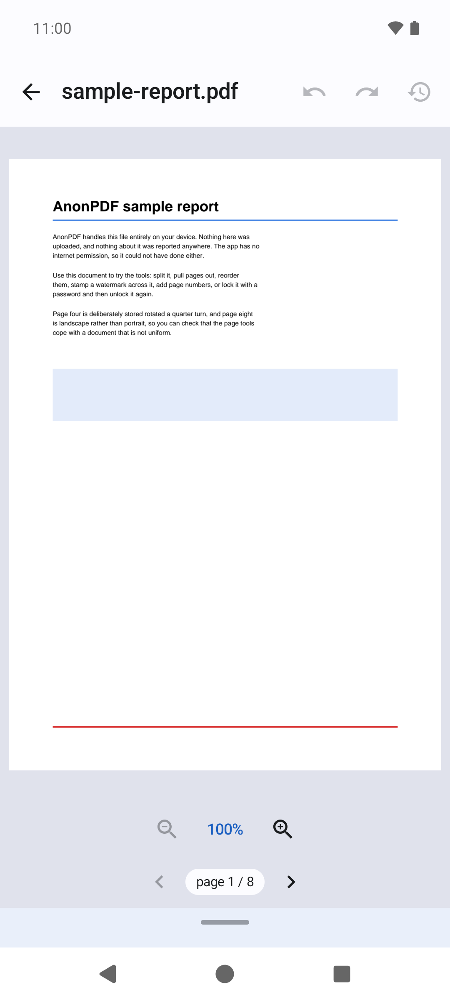
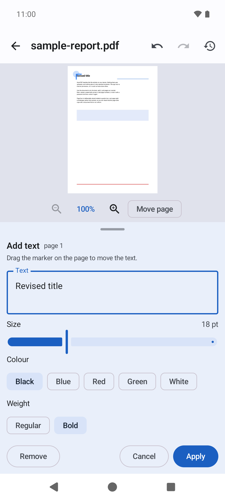
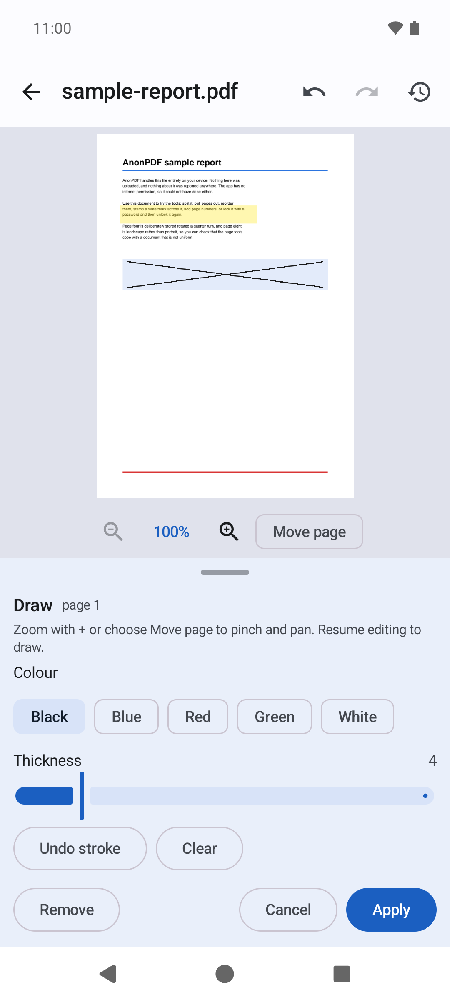
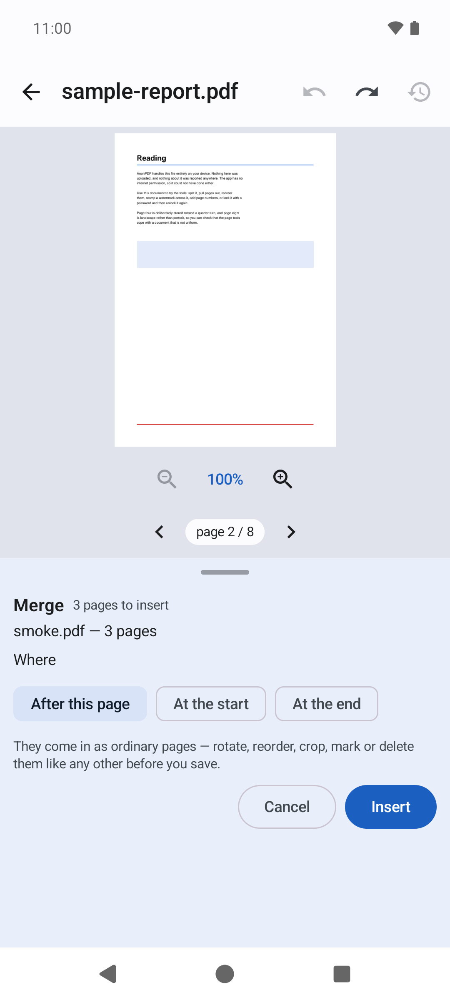

# AnonPDF

[English](../../README.md) · [Deutsch](README.de.md) · [Español](README.es.md) · [Français](README.fr.md) · [हिन्दी](README.hi.md) · [Português](README.pt-BR.md) · [Русский](README.ru.md) · **中文**

一款只在你的设备上工作、别无他处的 PDF 阅读和编辑应用。

**无广告。无账户。无追踪。无付费版。无网络权限。**

之所以有 AnonPDF，是因为其他 PDF 应用似乎都想要订阅、云端账户，还想看看你的文档。这个应用什么都不要。它无法上传你的文件，因为它根本没有访问网络的权限——这不是隐私政策里的承诺，而是由操作系统强制执行的事实。

> 本译文借助机器翻译完成。以[英文 README](../../README.md) 为准，欢迎指正。

## 下载

- **Android：**[最新版本](https://github.com/FanFeast/anonpdf/releases/latest)中的 APK。即将上架 Google Play。
- **Linux：**从 [Snap Store](https://snapcraft.io/anonpdf) 运行 `sudo snap install anonpdf`，或下载[最新版本](https://github.com/FanFeast/anonpdf/releases/latest)中的便携包
  `AnonPDF-…-linux-x86_64.tar.gz`：解压后双击 `AnonPDF.AppImage`。无需安装。
- **Windows：**下载[最新版本](https://github.com/FanFeast/anonpdf/releases/latest)中的便携包 `AnonPDF-…-windows-x64.zip`：解压后运行 `AnonPDF.exe`。

桌面版使用相同的引擎和编辑器，运行在原生窗口中，遵循同样的规则：不访问网络。

| 文件库 | 阅读 | 你的文件 |
|---|---|---|
|  |  |  |

## 编辑器

大部分工作都在这里完成。选择页面，随意叠加多项修改，实时查看真实渲染效果，最后一次性写入文件。保存之前不会写入磁盘，原文件也永远不会被修改。

| 编辑 | 拖动排序 | 收起工具 |
|---|---|---|
|  |  |  |

| 遮盖并重写 | 高亮与手绘 | 合并后继续编辑 |
|---|---|---|
|  |  |  |

- **所有工具都在这里**，分为四页：*页面*、*内容*、*整个文件*、*转换与加密*。处理整个文件的工具拿到的是已应用你待保存修改的文档。
- **填写 PDF 表单**：文本框、复选框、单选按钮和下拉列表，输入时即可预览，保存时还可以把填写内容锁定到页面上。
- **合并会插入到你指定的位置。** 另一个 PDF 的页面会作为普通页面加入，可以旋转、排序、裁剪或删除。
- **不仅编辑页面，还能编辑内容。** 用涂白遮住内容并在上面写字、高亮一段文字，或者手绘。涂白会真正删除被遮住的内容：框下的页面会变成图片，被遮住的文字之后无法复制或搜索。
- **拖动即可排序**，**轻点即可多选页面**。
- 整个历史都可以**撤销和重做**。

预览不是近似效果：它由写入最终文件的同一段代码生成，并有测试逐像素核对二者一致。

## 承诺，以及如何验证

AnonPDF 只声明了**一项**权限：

```
android.permission.MANAGE_EXTERNAL_STORAGE
```

它让内置浏览功能可以列出设备上的 PDF。这项权限是**可选的**：拒绝后，一切仍可通过系统文件选择器使用，而选择器不需要任何权限。Android 把它归为“特殊应用权限”，所以它不会出现在应用的普通权限页面上。

你可以确信的是：

- **没有 `INTERNET` 权限。** 系统会拒绝任何连接。没有服务器、没有遥测、没有崩溃报告、没有广告网络。测试会验证建立连接和解析域名都确实失败。
- **没有统计或广告依赖。** 只有 AndroidX、Kotlin 和 PdfBox-Android。
- **`allowBackup=false`**，文档也不会通过云端备份离开设备。
- **如果出现任何其他权限，测试会让构建失败。**

亲自验证：

```bash
apkanalyzer manifest permissions app-release.apk
```

### 它会存储什么

| 内容 | 位置 | 如何删除 |
|---|---|---|
| 最多 20 个最近文件的名称 | 应用私有存储，不参与备份 | 设置 → 清除最近的文件 |
| 正在编辑的文件的工作副本 | 应用缓存 | 设置 → 删除临时工作文件；每次启动也会清除 |
| 三项显示偏好设置 | 应用私有存储 | 卸载应用 |

这就是全部内容。没有任何形式的标识符。

## 功能

**阅读：**连续滚动、双指缩放、跳转页面、文字搜索、夜间模式、打开受密码保护的 PDF。

**查找文件：**内置浏览功能列出设备上所有 PDF，也可以按文件夹浏览，或使用系统选择器。

**编辑**（一次完成，带预览）：旋转、裁剪、调整尺寸（A3、A4、A5、Letter、Legal、Tabloid）、删除、排序、合并、填写表单、文字、涂白、高亮、手绘、水印和页码。

**整个文件：**合并、拆分、提取页面、压缩、PDF 转 JPG/PNG、图片转 PDF、提取文字、用 AES-256 加密或移除已知密码，以及签名。

**保存时：**可选择移除 PDF 中的隐藏信息（作者、创建软件、日期、XMP 元数据、附件、脚本以及批注上的姓名）。

**语言：**英语、德语、西班牙语、法语、印地语、巴西葡萄牙语、俄语和简体中文，跟随设备语言。

## 刻意不包含的功能

- **转换为 Word、Excel 或 PowerPoint。** 要做好需要完整的办公文档引擎。
- **OCR。** 从扫描件中识别文字需要大型模型或服务器。
- **云同步、账户、分享链接。** 重点就是什么都不离开设备。
- **XFA 表单**，这种格式只有 Adobe 的应用能填写。
- **加密数字签名。** “签名 PDF”放置的是签名图片：相当于纸上的墨迹，不是证书。

## 系统要求

- Android 12 或更高版本；安装后约 15 MB
- 桌面版需要 Linux x86-64 或 64 位 Windows

## 构建、测试与架构

请参阅[英文 README](../../README.md#building)。

## 许可证

MIT。参见 [LICENSE](../../LICENSE)。
